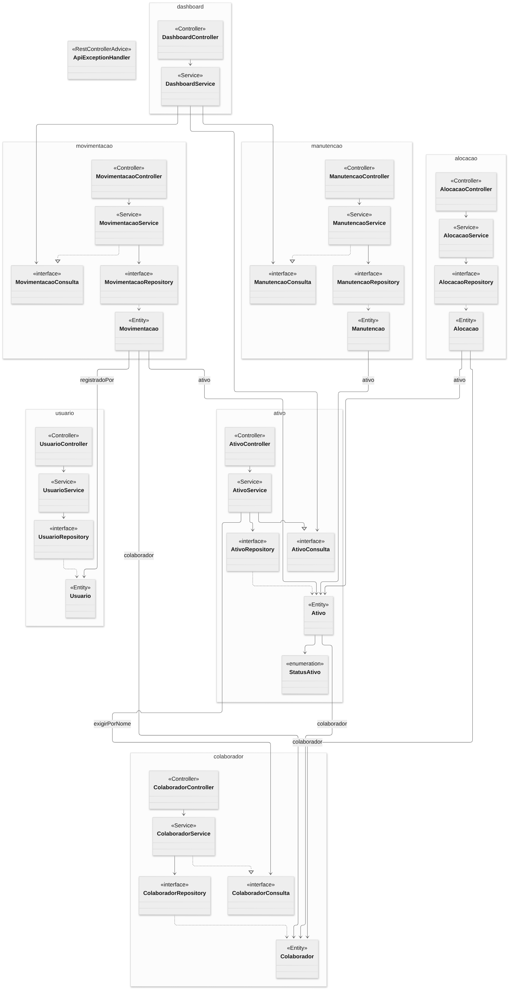
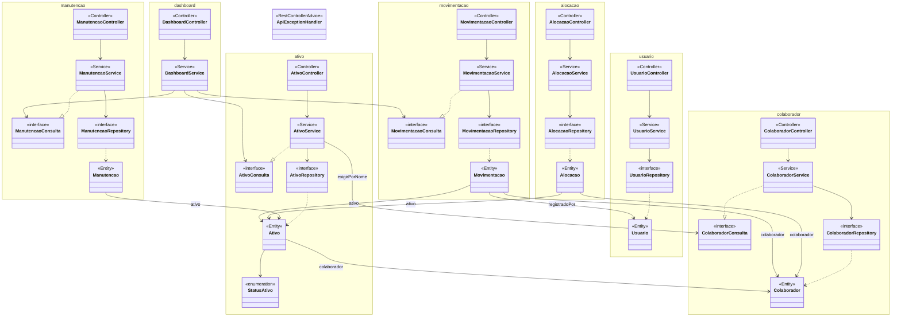
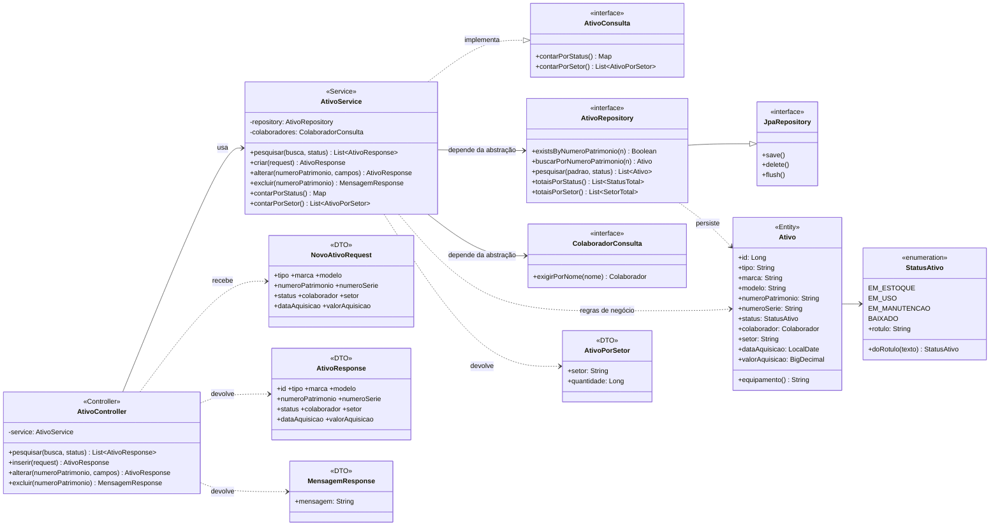
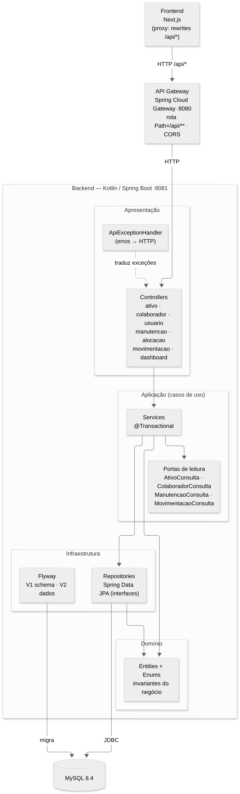
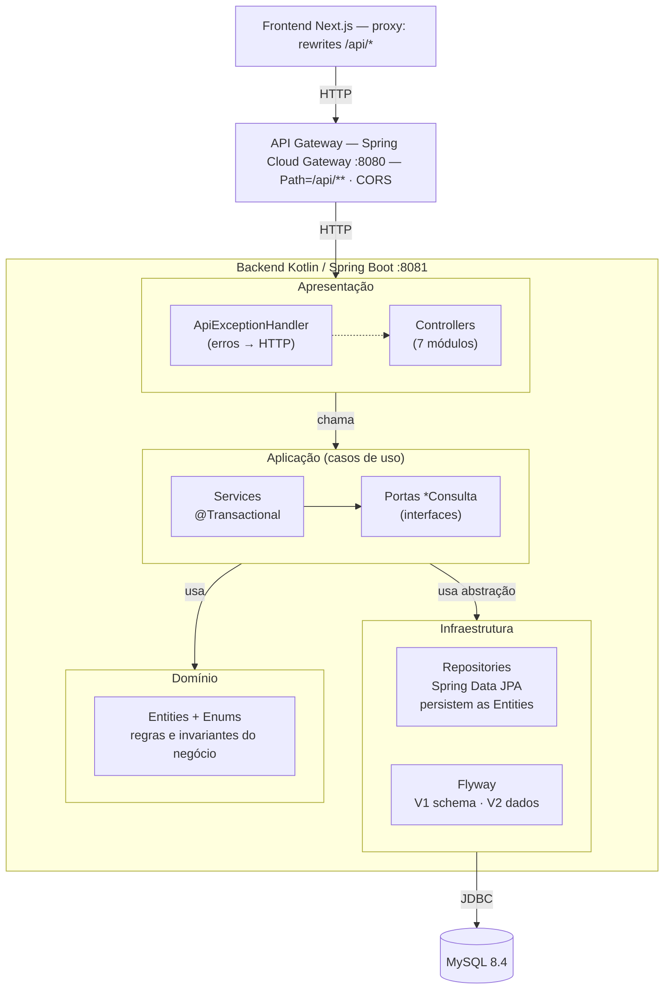
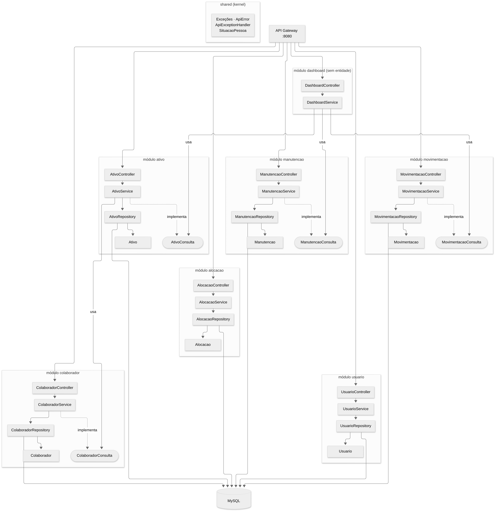
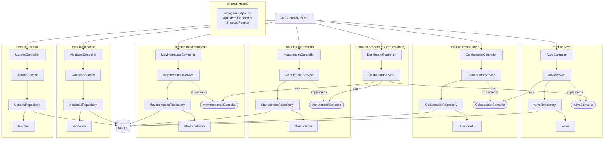

# Diagramas do backend — Vertical Slice + Clean Architecture + SOLID

Backend Kotlin/Spring Boot refatorado. Cada diagrama está em **Mermaid** (renderiza no GitHub) e em **imagem PNG** (pasta `docs/tde2/diagramas/`). As fontes `.mmd` ficam na mesma pasta.

## Onde cada princípio aparece

| Princípio | Aplicação no código |
|---|---|
| Vertical Slice | Uma pasta por módulo, cada uma com Entity, DTO, Controller, Service e Repository |
| Clean Architecture | Dependências apontam para dentro: Controller → Service → Repository → Entity; o domínio não conhece Spring MVC nem MySQL |
| SRP | Controller só HTTP; Service só caso de uso; Repository só persistência; `ApiExceptionHandler` só traduz erros |
| OCP | Novo módulo = nova pasta, sem alterar os existentes |
| LSP | Qualquer implementação de `*Consulta` substitui outra (mocks nos testes) |
| ISP | Portas pequenas: `ColaboradorConsulta` expõe só `exigirPorNome` |
| DIP | Services dependem de interfaces (`Repository`, `*Consulta`), nunca de classes concretas de outros módulos |

## 1. Diagrama de classes — visão geral dos módulos

Cada módulo (Vertical Slice) tem Controller → Service → Repository → Entity. Entre módulos só existem dependências por interfaces `*Consulta` (DIP) e as relações JPA (chaves estrangeiras) entre entidades.

Código Mermaid

## 2. Diagrama de classes — detalhe do módulo `ativo`

Mostra atributos, métodos, DTOs e as abstrações das quais o `AtivoService` depende (`AtivoRepository` e `ColaboradorConsulta`). Os demais módulos seguem o mesmo molde.

Código Mermaid

## 3. Diagrama de componentes — camadas da Clean Architecture

Fluxo Frontend → Proxy → API Gateway → Backend → MySQL. Dentro do backend: Apresentação → Aplicação → (Infraestrutura, Domínio). O domínio não depende de nada.

Código Mermaid

## 4. Diagrama de componentes — módulos (Vertical Slice)

Cada fatia vertical é autônoma (Controller, Service, Repository, Entity). As setas `usa` entre módulos passam exclusivamente pelas portas `*Consulta`.

Código Mermaid

