# Documentação de Arquitetura — Sistema de Controle de Ativos de Informática (TDE 2)

**Disciplina:** PJBL — PUCPR  
**Repositório:** https://github.com/FabioVisentainer/ativos-ti-pjbl  
**Branch do backend refatorado:** `refactor/vertical-slice-clean-architecture`  
**Formato:** Arc42 (11 seções + glossário), Modelo C4 (níveis 1 a 4), diagrama ER e Software Architecture Canvas.

## Integrantes e atividades realizadas

| Aluno | O que realizou |
|---|---|
| Fabio Augusto Tomaselli Visentainer | Definiu a arquitetura do software em conjunto com Mateus Zanettin Dall'Agnol (stack, módulos em Vertical Slice, Clean Architecture e SOLID). Discutiu a estrutura do backend com Tiago Kasprzak Gorri. |
| Mateus Zanettin Dall'Agnol | Definiu a arquitetura do software em conjunto com Fabio Visentainer, incluindo a rearquitetura do backend e a organização dos módulos. |
| Tiago Kasprzak Gorri | Participou da discussão do backend com Fabio Visentainer, contribuindo nas definições técnicas de Controller, Service e Repository. |
| Matheus Marcondes Muller | Elaborou e ajustou os prompts enviados à IA generativa, em conjunto com o grupo. |

Todos os integrantes participaram das decisões sobre a arquitetura e sobre os prompts utilizados. Os prompts desta documentação estão em `docs/tde3/PROMPT.md`.

## Como ler este documento

Tudo o que está descrito como **implementado** existe no código da branch indicada. O que não existe no código aparece marcado como **[Proposta de evolução]**. Nenhum estilo arquitetural é apresentado como existente se o código não o implementa (veja a seção 4.2).

Os diagramas estão em `diagramas/` em três formatos: `.mmd` (código Mermaid), `.png` (alta resolução) e `.svg` (vetorial). Para gerar um único PDF, concatene este arquivo no conversor de sua preferência a partir desta pasta, pois os caminhos das imagens são relativos.

## Sumário

1. Introdução e Objetivos
2. Restrições
3. Contexto e Escopo
4. Estratégia da Solução
5. Visão de Blocos de Construção
6. Visão de Tempo de Execução
7. Visão de Implantação
8. Conceitos Transversais
9. Decisões de Arquitetura (ADRs)
10. Requisitos de Qualidade
11. Riscos e Débitos Técnicos
12. Glossário
- Anexo A — Modelo C4 (níveis 1 a 4)
- Anexo B — Diagrama Entidade-Relacionamento
- Anexo C — Software Architecture Canvas
- Anexo D — Estilos arquiteturais considerados

---

# 1. Introdução e Objetivos

## 1.1 Visão geral dos requisitos

O sistema controla o parque de ativos de TI de uma empresa (notebooks, monitores, periféricos etc.). Funcionalidades presentes na API (referências RF conforme o documento de requisitos do projeto):

| Funcionalidade | Rota | Operações | RF |
|---|---|---|---|
| Ativos | `/api/ativos` | pesquisar (busca e status), criar, alterar parcialmente, excluir (por número de patrimônio) | RF13, RF17, RF19, RF20, RF26 |
| Colaboradores | `/api/colaboradores` | listar | RF09, RF12 |
| Usuários e perfis | `/api/usuarios` | listar | RF06, RF07 |
| Alocações | `/api/alocacoes` | listar | RF21, RF22, RF25 |
| Manutenções | `/api/manutencoes` | listar | RF27 a RF31 |
| Movimentações | `/api/movimentacoes` | listar | — |
| Dashboard | `/api/dashboard` | indicadores agregados | RF35 |

O frontend tem login simulado (SSO mock, RF05) e sete telas, incluindo relatórios com exportação CSV (RF32 a RF36).

## 1.2 Objetivos de qualidade

| Prioridade | Objetivo | Motivação |
|---|---|---|
| 1 | Manutenibilidade | Estrutura em fatias verticais e camadas para evoluir um módulo sem tocar nos demais |
| 2 | Testabilidade | Services dependem de interfaces (repositórios e portas `*Consulta`), permitindo testes com dublês |
| 3 | Compatibilidade | O contrato REST (rotas e JSON) do protótipo original foi preservado para o frontend |
| 4 | Integridade dos dados | Restrições `UNIQUE`, `FOREIGN KEY` e `CHECK` no MySQL; erros devolvidos em formato único |
| 5 | Portabilidade | Execução reproduzível com Docker Compose |

## 1.3 Partes interessadas

| Papel | Expectativa |
|---|---|
| Técnico de TI | Cadastrar, alterar e dar baixa em ativos com rapidez |
| Gestor de TI | Indicadores e custos confiáveis |
| Colaborador | Ver os ativos sob sua responsabilidade |
| Equipe de desenvolvimento (grupo de 4) | Código organizado, documentação fiel ao código |
| Professor/avaliador | Aplicação demonstrável de Vertical Slice, Clean Architecture e SOLID |

---

# 2. Restrições

## 2.1 Restrições técnicas

| Restrição | Detalhe |
|---|---|
| Linguagem e framework do backend | Kotlin 2.4 com Spring Boot 4.1 |
| JDK | 21 (toolchain do Gradle) |
| Build | Gradle 9.8 com Kotlin DSL (`gradlew`) |
| Banco de dados | MySQL 8.4 em contêiner Docker, versionado por Flyway |
| Persistência | Spring Data JPA com Hibernate; `ddl-auto: none` (o esquema vem só das migrations) |
| Gateway | Spring Cloud Gateway (2025.1) em contêiner |
| Frontend | Next.js (React), mantido do projeto anterior |
| Cadeia de chamadas | Frontend, Proxy, API Gateway, Backend, MySQL |

## 2.2 Restrições organizacionais

- Trabalho acadêmico (PUCPR) em grupo de 4 alunos, com uso obrigatório de IA generativa.
- Aplicar Vertical Slice, Clean Architecture e SOLID no backend.
- O código original em Node/Azure Functions (pasta `api/`) foi mantido sem alteração; o novo backend fica em `backend/`.

## 2.3 Convenções

- Pacote raiz `br.pucpr.ativos`; um subpacote por módulo.
- Cada módulo tem `Entity`, `Dto`, `Controller`, `Service` e `Repository`.
- Comunicação entre módulos somente por interfaces `*Consulta`.
- Erros em JSON `{"error": "mensagem"}`.

---

# 3. Contexto e Escopo

## 3.1 Contexto de negócio

O sistema é usado por três perfis (Colaborador, Técnico de TI e Gestor de TI) e prevê integração com o Microsoft Entra ID para login corporativo. Hoje essa integração é **simulada no frontend**; o backend não autentica requisições (ver seção 11).

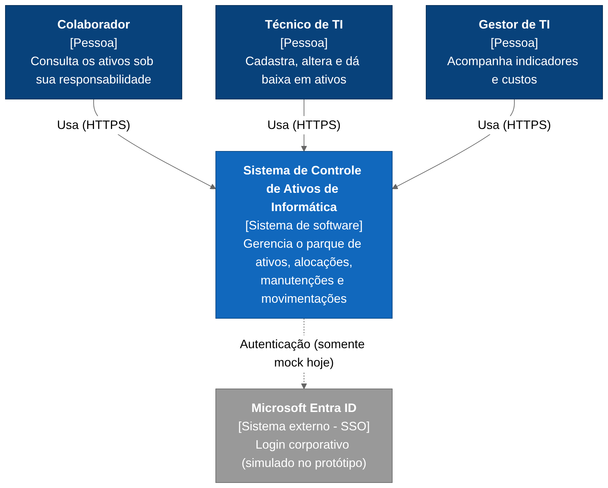

*Figura 3.1 — Contexto do sistema.*

## 3.2 Contexto técnico

| Interface | Origem | Destino | Protocolo | Formato |
|---|---|---|---|---|
| Navegação | Navegador | Frontend Next.js | HTTP(S) | HTML/JS |
| API | Frontend | API Gateway (:8080) | HTTP | JSON, rotas `/api/**` |
| Encaminhamento | API Gateway | Backend (:8081) | HTTP | JSON |
| Persistência | Backend | MySQL (:3306) | JDBC | SQL |

Em modo de desenvolvimento com o backend, o Next.js atua como proxy reverso (`rewrites` em `next.config.ts`, ativado pela variável `GATEWAY_URL`) e envia `/api/*` ao gateway. Sem essa variável, o frontend é exportado como site estático para o Azure Static Web Apps.

---

# 4. Estratégia da Solução

## 4.1 Decisões centrais

| Objetivo | Abordagem | Onde está |
|---|---|---|
| Manutenibilidade | Vertical Slice: um pacote por módulo (ativo, colaborador, usuario, manutencao, alocacao, movimentacao, dashboard) | `backend/src/main/kotlin/br/pucpr/ativos/` |
| Independência do framework | Clean Architecture: Controller, Service, Repository, Entity; dependências apontam para dentro | Todos os módulos |
| Baixo acoplamento entre módulos | Portas de leitura `AtivoConsulta`, `ColaboradorConsulta`, `ManutencaoConsulta`, `MovimentacaoConsulta` (DIP e ISP) | Interfaces nos Services |
| Contrato estável | Mesmas rotas e JSON do protótipo | Controllers e DTOs |
| Entrada única | API Gateway com rota `/api/**` e CORS | `gateway/` |
| Esquema controlado | Flyway: `V1__schema.sql` e `V2__dados_iniciais.sql` | `backend/src/main/resources/db/migration/` |
| Erros consistentes | `ApiExceptionHandler` (`@RestControllerAdvice`) | `shared/` |

## 4.2 Aplicação dos estilos arquiteturais

| Estilo | Situação no projeto | Evidência ou observação |
|---|---|---|
| Vertical Slice | **Implementado** | Pacote por módulo com todas as camadas dentro |
| Clean Architecture | **Implementado** | Dependency rule respeitada; Services dependem de interfaces |
| API Gateway | **Implementado** | Spring Cloud Gateway, `gateway/src/main/resources/application.yml` |
| Serverless | **Parcial / legado** | O protótipo original usa Azure Functions (`api/`) e Static Web Apps; o novo backend não é serverless |
| Microfrontend | **[Proposta de evolução]** | O frontend é uma aplicação Next.js única; o design system em pacote separado está apenas descrito em skill |
| BFF + Microsserviços + Database per Service | **[Proposta de evolução]** | O backend é um **monólito modular** com um único MySQL. O proxy do Next.js apenas encaminha chamadas e não agrega dados (não é um BFF) |
| EDA | **[Proposta de evolução]** | Não há broker nem eventos; toda comunicação é síncrona HTTP |

A arquitetura-alvo proposta está no Anexo D. A modularização em fatias verticais com portas `*Consulta` foi desenhada para permitir a extração futura de cada módulo como serviço.

---

# 5. Visão de Blocos de Construção

## 5.1 Nível 1 — Sistema completo (contêineres)

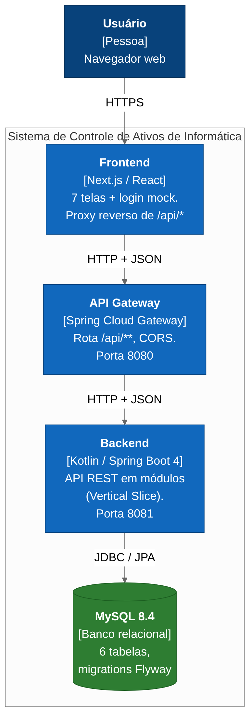

*Figura 5.1 — Contêineres do sistema.*

| Bloco | Responsabilidade | Tecnologia |
|---|---|---|
| Frontend | Telas, login mock, proxy de `/api/*` | Next.js |
| API Gateway | Roteamento `/api/**`, CORS, cabeçalho `X-Served-By` | Spring Cloud Gateway |
| Backend | Regras de negócio e API REST | Kotlin, Spring Boot |
| MySQL | Armazenamento relacional | MySQL 8.4 |

## 5.2 Nível 2 — Backend: módulos (Vertical Slice)

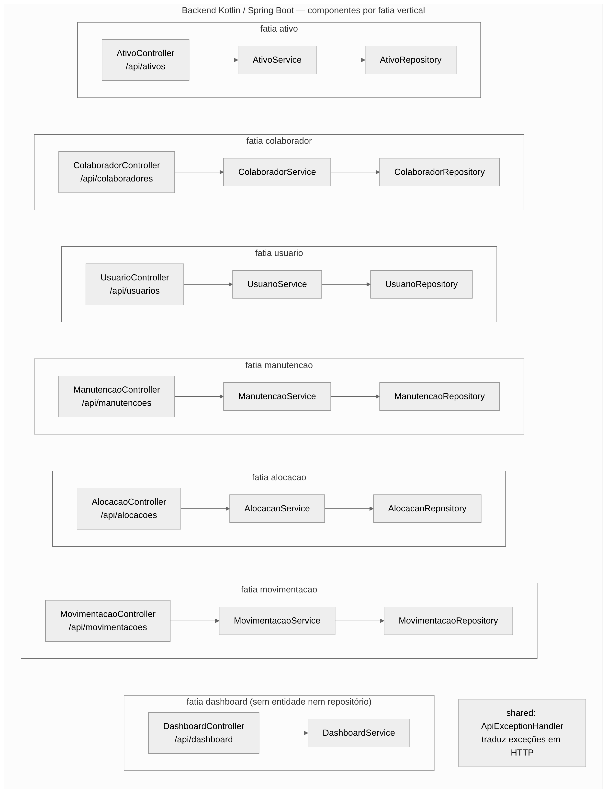

*Figura 5.2 — Fatias verticais do backend. Entrada pelo gateway e saída para o MySQL, conforme a Figura 5.1.*

| Módulo | Controller (rota) | Entidade / tabela | Observação |
|---|---|---|---|
| ativo | `/api/ativos` | `Ativo` / `ativo` | CRUD; implementa `AtivoConsulta`; usa `ColaboradorConsulta` |
| colaborador | `/api/colaboradores` | `Colaborador` / `colaborador` | Implementa `ColaboradorConsulta` |
| usuario | `/api/usuarios` | `Usuario` / `usuario` | Perfis COLABORADOR, TECNICO_TI, GESTOR_TI |
| manutencao | `/api/manutencoes` | `Manutencao` / `manutencao` | Implementa `ManutencaoConsulta` (custos) |
| alocacao | `/api/alocacoes` | `Alocacao` / `alocacao` | Listagem |
| movimentacao | `/api/movimentacoes` | `Movimentacao` / `movimentacao` | Implementa `MovimentacaoConsulta` |
| dashboard | `/api/dashboard` | — | Sem entidade; agrega por portas |
| shared | — | — | Exceções, `ApiError`, `ApiExceptionHandler` |

## 5.3 Nível 3 — Camadas (Clean Architecture)

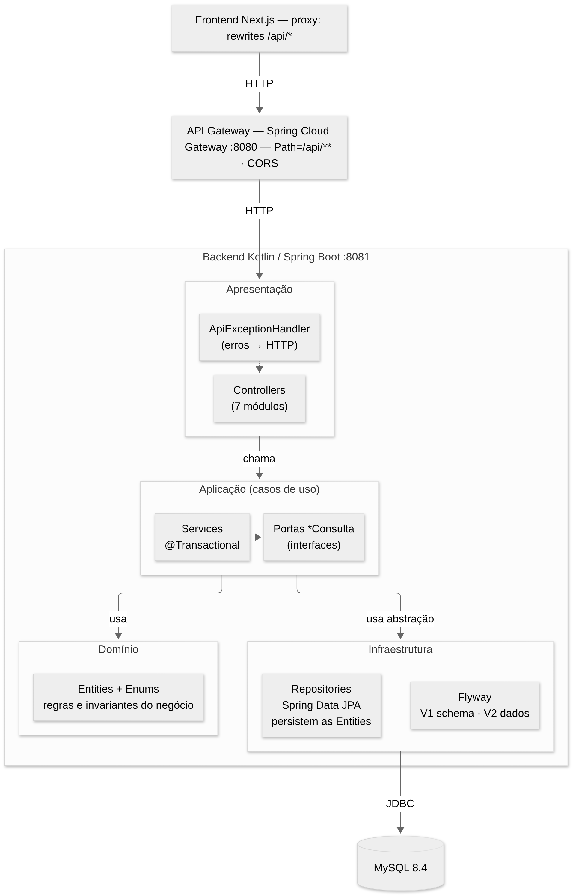

*Figura 5.3 — Camadas e regra de dependência.*

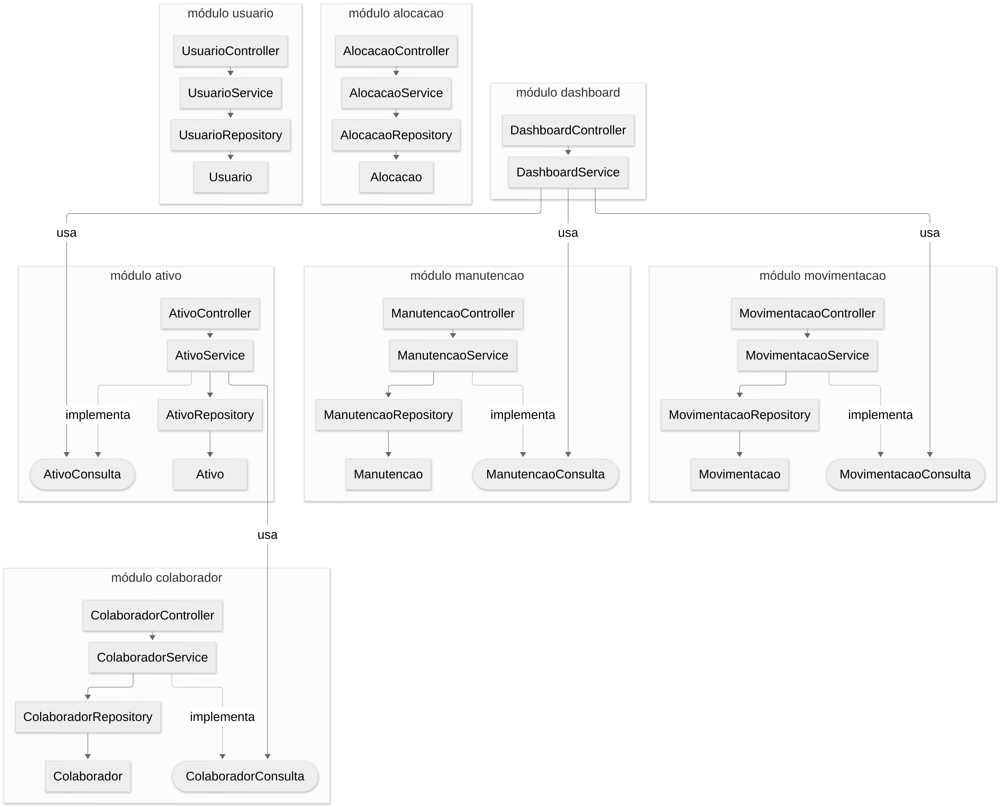

*Figura 5.4 — Módulos e dependências permitidas entre eles (somente por `*Consulta`).*

## 5.4 Classes principais

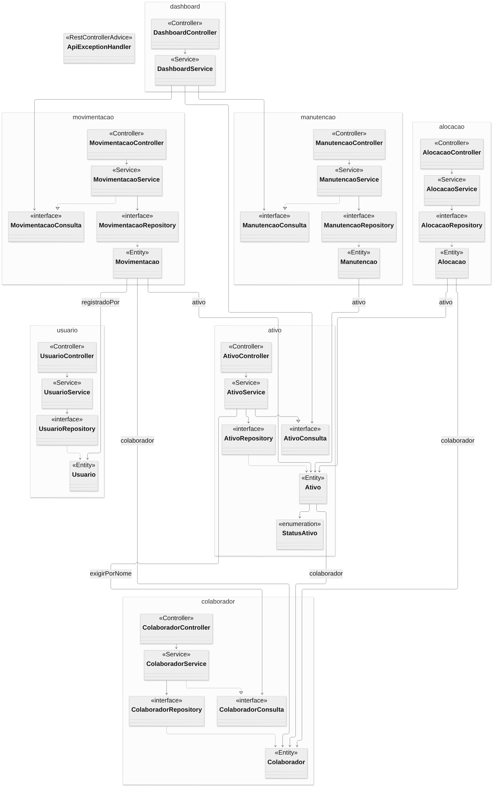

*Figura 5.5 — Classes de todos os módulos.*

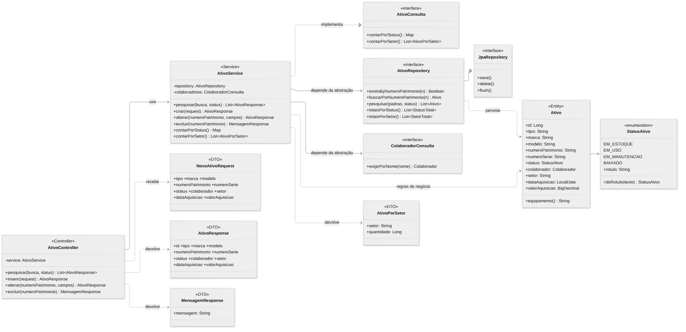

*Figura 5.6 — Detalhe do módulo `ativo`.*

---

# 6. Visão de Tempo de Execução

## 6.1 Cenário 1 — Criar ativo

Valida duplicidade de patrimônio e, se informado, exige que o colaborador exista.

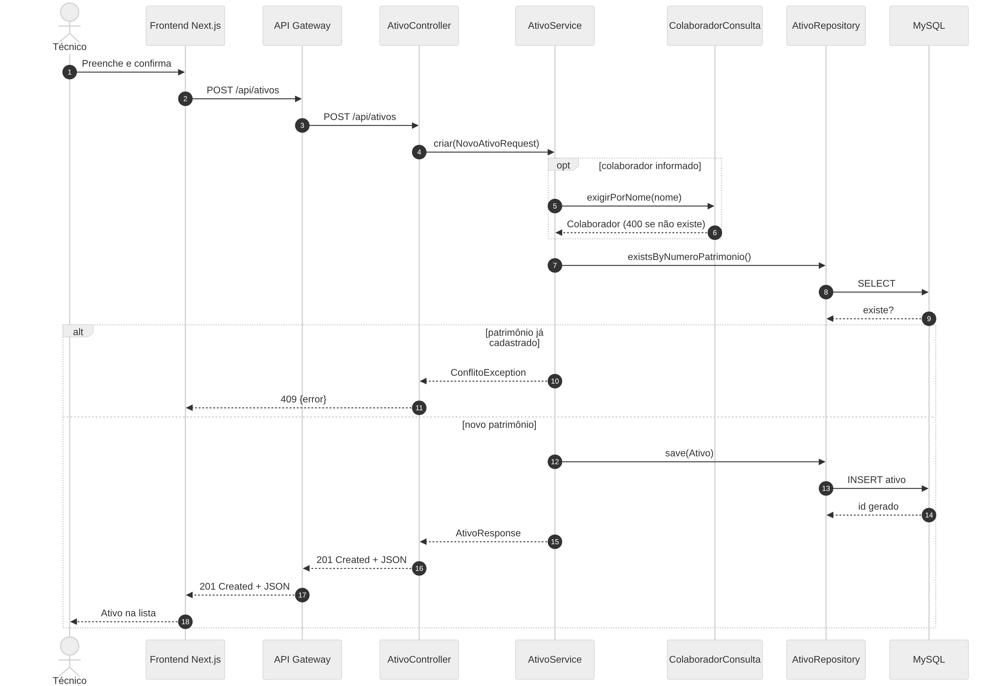

*Figura 6.1 — `POST /api/ativos`.*

## 6.2 Cenário 2 — Consultar o dashboard

O `DashboardService` não acessa repositórios: usa só as portas de leitura dos outros módulos.

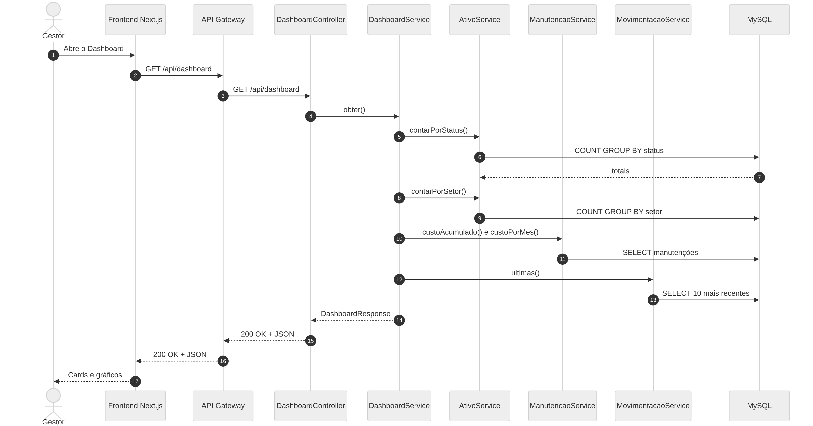

*Figura 6.2 — `GET /api/dashboard`.*

## 6.3 Cenário 3 — Excluir ativo com vínculos

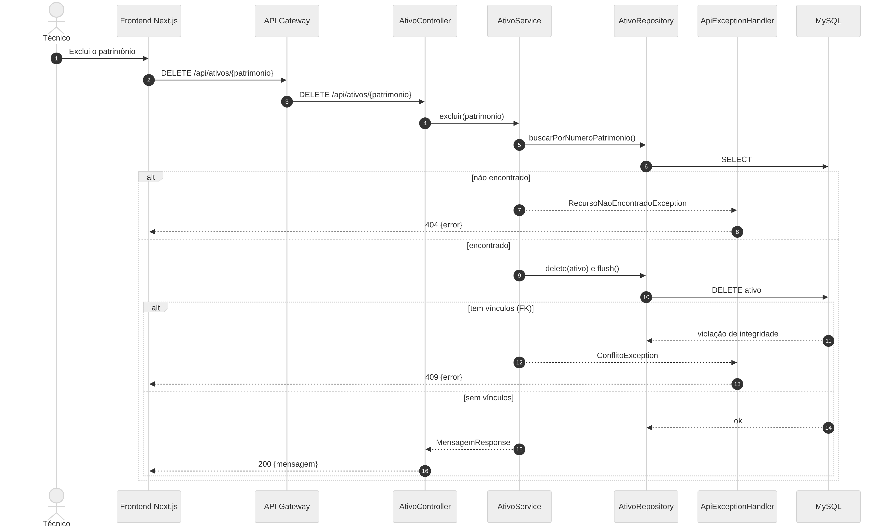

*Figura 6.3 — `DELETE /api/ativos/{patrimonio}`. Se houver manutenções, alocações ou movimentações, a chave estrangeira impede a exclusão e a API responde 409.*

## 6.4 Códigos de resposta

| Situação | HTTP | Exceção |
|---|---|---|
| Criação bem-sucedida | 201 | — |
| Recurso não encontrado | 404 | `RecursoNaoEncontradoException` |
| Patrimônio duplicado ou ativo com vínculos | 409 | `ConflitoException` |
| Dados inválidos (status, data, valor, colaborador inexistente) | 400 | `RegraDeNegocioException` |
| Corpo ou parâmetro ilegível | 400 | tratado em `ApiExceptionHandler` |
| Falha inesperada | 500 | mensagem genérica, detalhe só no log |

---

# 7. Visão de Implantação

## 7.1 Ambiente atual (Docker Compose)

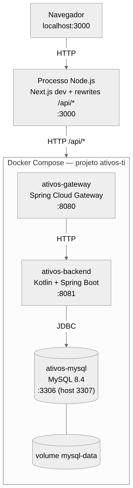

*Figura 7.1 — `docker compose up --build` sobe MySQL, backend e gateway; o frontend roda via Node.*

| Contêiner | Imagem / build | Porta | Dependência |
|---|---|---|---|
| `ativos-mysql` | `mysql:8.4`, volume `mysql-data` | 3307 (host) → 3306 | — (com healthcheck) |
| `ativos-backend` | `backend/Dockerfile` | 8081 | MySQL saudável |
| `ativos-gateway` | `gateway/Dockerfile` | 8080 | backend |

Variáveis: `DB_USER`, `DB_PASSWORD`, `DB_ROOT_PASSWORD`, `CORS_ALLOWED_ORIGINS`, `BACKEND_URL`, `MYSQL_HOST_PORT` (ver `.env.example`).

## 7.2 Implantação do protótipo original (referência)

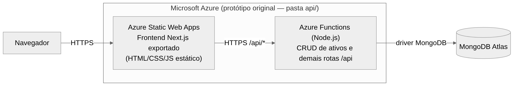

*Figura 7.2 — Frontend estático no Azure Static Web Apps e Azure Functions com MongoDB. Mantido em `api/`; não faz parte do novo backend.*

**[Proposta de evolução]** Hospedar os contêineres do gateway e do backend em um serviço gerenciado de contêineres, com MySQL gerenciado, mantendo o frontend estático.

---

# 8. Conceitos Transversais

| Conceito | Como é tratado no código |
|---|---|
| Modelo de domínio | Entidades JPA por módulo; enums `StatusAtivo`, perfis e tipos gravados como `VARCHAR` com `CHECK` |
| Persistência | Spring Data JPA; consultas JPQL em `@Query`; migrations Flyway |
| Transações | `@Transactional` nos Services (`readOnly = true` nas leituras) |
| Tratamento de erros | Exceções de domínio traduzidas em um único `ApiExceptionHandler`; corpo `{"error": ...}` |
| DTOs | Request e Response separados das entidades (`*Dto.kt`); a entidade não vaza pela API |
| Atualização parcial | `PUT /api/ativos/{patrimonio}` altera só os campos enviados; campos não editáveis são ignorados |
| Segurança | **Ainda não implementada** no backend (sem autenticação nem autorização); CORS restrito por origem no gateway. Ver seção 11 |
| Logging | SLF4J; erros inesperados e violações de integridade registrados no log, sem expor detalhes ao cliente |
| Observabilidade | Actuator no gateway (`health`, `info`, `gateway`) |
| Testes | Testes unitários com MockK (`AtivoServiceTest`, `DashboardServiceTest`) e `AtivoControllerTest` com MockMvc standalone |
| Configuração | `application.yml` com variáveis de ambiente (`DB_URL`, `DB_USER`, `DB_PASSWORD`) |
| Internacionalização | Mensagens de erro em português do Brasil |

---

# 9. Decisões de Arquitetura (ADRs)

### ADR-01 — Vertical Slice por módulo
- **Contexto:** o backend original agrupava por tipo técnico, com acoplamento alto.
- **Decisão:** um pacote por módulo, contendo Entity, DTO, Controller, Service e Repository.
- **Consequências:** mudanças ficam localizadas; há alguma repetição de estrutura entre módulos.

### ADR-02 — Clean Architecture com regra de dependência
- **Decisão:** Controller depende do Service, Service depende de interfaces (Repository e portas), Entity não depende de nada.
- **Consequências:** Services testáveis sem banco e sem HTTP; custo de mais interfaces.

### ADR-03 — Portas `*Consulta` para acesso entre módulos
- **Decisão:** um módulo nunca acessa o repositório nem a entidade de outro; usa uma interface de leitura.
- **Consequências:** DIP e ISP respeitados; o `DashboardService` não tem repositório próprio.

### ADR-04 — Migração para Kotlin, Spring Boot e MySQL
- **Contexto:** requisito do grupo e do trabalho (backend em Kotlin/Spring, MySQL).
- **Decisão:** novo backend em `backend/`; protótipo Node/MongoDB mantido em `api/`.
- **Consequências:** o contrato REST foi preservado; diferenças de comportamento documentadas em `docs/tde2/REFATORACAO.md` (por exemplo, DELETE com histórico retorna 409).

### ADR-05 — API Gateway com Spring Cloud Gateway
- **Decisão:** entrada única `/api/**` com CORS centralizado, em contêiner próprio.
- **Consequências:** o frontend desconhece o backend; um salto de rede adicional. Autenticação no gateway é evolução futura.

### ADR-06 — Proxy no Next.js (`rewrites`)
- **Decisão:** com `GATEWAY_URL` definido, o Next.js encaminha `/api/*` ao gateway; sem a variável, mantém a exportação estática.
- **Consequências:** o navegador fala com uma única origem; o modo estático do Azure continua funcionando.

### ADR-07 — Flyway e `ddl-auto: none`
- **Decisão:** o esquema é versionado em SQL (V1 esquema, V2 dados iniciais) e o Hibernate não altera o banco.
- **Consequências:** esquema reproduzível e revisável; mudanças exigem nova migration.

### ADR-08 — Docker Compose para o ambiente
- **Decisão:** MySQL, backend e gateway sobem juntos com `docker compose up --build`.
- **Consequências:** ambiente reproduzível; o frontend continua fora do Compose.

### ADR-09 — Monólito modular agora, microsserviços como evolução
- **Decisão:** manter um único backend e um único banco, mas com fronteiras de módulo prontas para extração.
- **Consequências:** simplicidade operacional para o escopo acadêmico; BFF, Database per Service, EDA e microfrontends ficam documentados como proposta (Anexo D).

---

# 10. Requisitos de Qualidade

## 10.1 Árvore de qualidade

| Qualidade | Atributo | Como é atendido |
|---|---|---|
| Manutenibilidade | Modularidade | Fatias verticais isoladas |
| Manutenibilidade | Legibilidade | Convenção única de camadas e nomes |
| Confiabilidade | Integridade | `UNIQUE`, `FK`, `CHECK`; 409 em vez de erro genérico |
| Testabilidade | Isolamento | Services dependem de interfaces |
| Compatibilidade | Contrato | Rotas e JSON do protótipo preservados |
| Portabilidade | Reprodução | Docker Compose e Gradle wrapper |
| Segurança | Autenticação/autorização | Não atendido (ver 11) |

## 10.2 Cenários de qualidade

| Id | Cenário | Resposta esperada | Situação |
|---|---|---|---|
| Q1 | Um desenvolvedor adiciona um campo em `Ativo` | Alteração restrita ao módulo `ativo` e a uma migration | Atendido pela estrutura |
| Q2 | Cadastro de ativo com patrimônio repetido | HTTP 409 com `{"error": ...}` | Implementado e testado |
| Q3 | Exclusão de ativo com manutenções | HTTP 409, sem apagar dados | Implementado |
| Q4 | Teste do `DashboardService` | Executa sem banco, com dublês das portas | Implementado (`DashboardServiceTest`) |
| Q5 | Novo integrante sobe o ambiente | `docker compose up --build` | Implementado, não validado em todos os ambientes |
| Q6 | Requisição sem credenciais | Deveria ser rejeitada | **Não atendido** |

---

# 11. Riscos e Débitos Técnicos

| Id | Item | Tipo | Impacto | Mitigação sugerida |
|---|---|---|---|---|
| R1 | O backend nunca foi compilado nem executado no ambiente de geração; podem existir pequenos ajustes de API na primeira build | Risco | Médio | Rodar `./gradlew build` e `docker compose up --build` |
| R2 | Sem autenticação e autorização no backend; login do frontend é simulado | Débito | Alto | Spring Security com OIDC (Entra ID), validação no gateway |
| R3 | Não há teste de integração com MySQL (por exemplo, Testcontainers) | Débito | Médio | Adicionar testes de integração dos repositórios |
| R4 | `Ativo.colaborador` duplica a informação de `Alocacao` | Débito | Médio | Definir uma fonte única da alocação atual |
| R5 | Pacote do design system descrito, mas não extraído do frontend | Débito | Baixo | Criar o pacote compartilhado |
| R6 | Endpoints só de leitura para colaboradores, usuários, alocações, manutenções e movimentações | Limitação | Médio | Implementar escrita e as regras de negócio correspondentes |
| R7 | Senhas padrão de banco no `docker-compose.yml` e `.env.example` | Risco (apenas desenvolvimento) | Médio | Usar segredos reais fora do ambiente local |
| R8 | Estilos Serverless, Microfrontend, BFF, Database per Service e EDA não implementados | Escopo | — | Ver Anexo D |

---

# 12. Glossário

| Termo | Definição |
|---|---|
| Ativo | Equipamento de TI controlado pelo sistema, identificado por número de patrimônio |
| Alocação | Vínculo entre um ativo e o colaborador que o retirou |
| Movimentação | Registro de operação sobre um ativo, feito por um usuário do sistema |
| Colaborador | Funcionário que pode receber ativos |
| Usuário | Pessoa com acesso ao sistema (perfil COLABORADOR, TECNICO_TI ou GESTOR_TI) |
| Vertical Slice | Organização do código por funcionalidade (módulo), e não por camada técnica |
| Clean Architecture | Arquitetura em camadas em que as dependências apontam para o domínio |
| SOLID | Cinco princípios de projeto orientado a objetos (SRP, OCP, LSP, ISP, DIP) |
| Porta `*Consulta` | Interface de leitura que um módulo expõe aos demais |
| API Gateway | Ponto único de entrada que roteia chamadas ao backend |
| BFF | Backend for Frontend: camada de backend dedicada a um tipo de cliente |
| EDA | Arquitetura orientada a eventos |
| Flyway | Ferramenta de versionamento de migrations de banco |
| ADR | Registro de decisão de arquitetura |

---

# Anexo A — Modelo C4

## A.1 Nível 1 — Contexto

*Pessoas: Colaborador, Técnico de TI e Gestor de TI. Sistema externo: Microsoft Entra ID (integração apenas simulada).*

## A.2 Nível 2 — Contêineres

## A.3 Nível 3 — Componentes (backend)

As dependências entre fatias existem somente pelas portas abaixo:

| Quem usa | Porta | Implementada por |
|---|---|---|
| `AtivoService` | `ColaboradorConsulta` | `ColaboradorService` |
| `DashboardService` | `AtivoConsulta` | `AtivoService` |
| `DashboardService` | `ManutencaoConsulta` | `ManutencaoService` |
| `DashboardService` | `MovimentacaoConsulta` | `MovimentacaoService` |

## A.4 Nível 4 — Código

**Diagrama de classes (visão geral)**

**Diagrama de classes (módulo ativo)**

**Diagrama de componentes (módulos)**

**Diagramas de sequência**

---

# Anexo B — Diagrama Entidade-Relacionamento

Baseado em `V1__schema.sql`, com as 6 tabelas reais do MySQL.

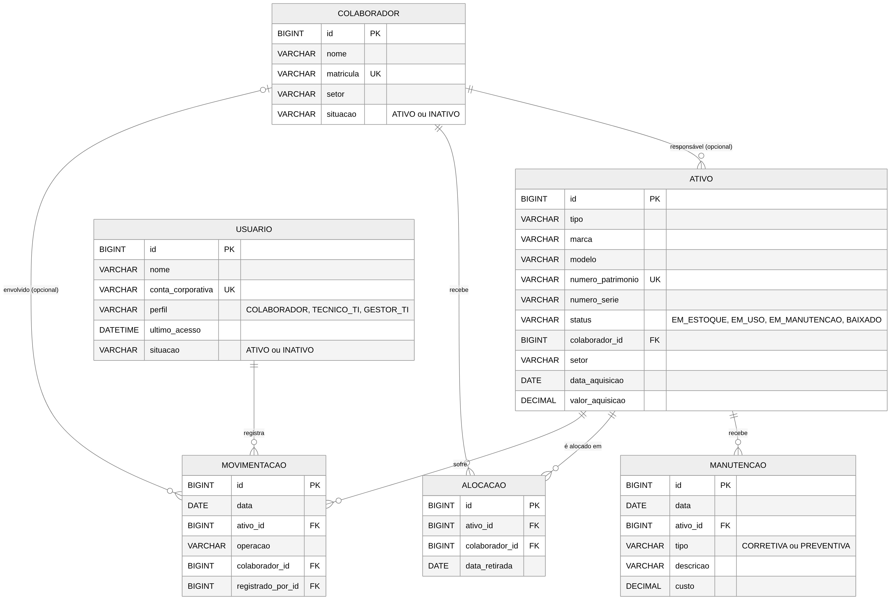

| Tabela | Chaves e restrições |
|---|---|
| `colaborador` | PK `id`; `UNIQUE(matricula)`; `CHECK situacao IN (ATIVO, INATIVO)` |
| `usuario` | PK `id`; `UNIQUE(conta_corporativa)`; `CHECK perfil` e `situacao` |
| `ativo` | PK `id`; `UNIQUE(numero_patrimonio)`; FK `colaborador_id` (opcional); `CHECK status IN (EM_ESTOQUE, EM_USO, EM_MANUTENCAO, BAIXADO)` |
| `manutencao` | PK `id`; FK `ativo_id`; `CHECK tipo IN (CORRETIVA, PREVENTIVA)` |
| `alocacao` | PK `id`; FK `ativo_id`; FK `colaborador_id` |
| `movimentacao` | PK `id`; FK `ativo_id`; FK `colaborador_id` (opcional); FK `registrado_por_id` para `usuario` |

---

# Anexo C — Software Architecture Canvas

| Bloco | Conteúdo |
|---|---|
| **Propósito** | Controlar o ciclo de vida dos ativos de TI: cadastro, alocação, manutenção, movimentação e indicadores |
| **Partes interessadas** | Técnico de TI, Gestor de TI, Colaborador, equipe de desenvolvimento, professor |
| **Requisitos funcionais principais** | Pesquisar, criar, alterar e excluir ativos; listar colaboradores, usuários, alocações, manutenções e movimentações; dashboard gerencial |
| **Atributos de qualidade** | Manutenibilidade, testabilidade, compatibilidade do contrato, integridade de dados, portabilidade |
| **Restrições** | Kotlin/Spring Boot, MySQL, Docker, JDK 21, Gradle Kotlin DSL; cadeia Frontend, Proxy, Gateway, Backend, Banco |
| **Estilos e padrões** | Vertical Slice, Clean Architecture, SOLID, API Gateway; monólito modular |
| **Estrutura (blocos)** | Frontend Next.js; Spring Cloud Gateway; backend com 7 módulos e `shared`; MySQL |
| **Tecnologias** | Next.js, Kotlin 2.4, Spring Boot 4.1, Spring Cloud Gateway, Hibernate/JPA, Flyway, MySQL 8.4, Docker Compose, MockK |
| **Dados** | 6 tabelas relacionais; enums gravados como texto com `CHECK` |
| **Integrações** | Entra ID (simulado); nenhuma integração real externa |
| **Implantação** | Docker Compose local; protótipo original no Azure Static Web Apps e Functions |
| **Segurança** | CORS por origem; sem autenticação ainda (débito R2) |
| **Riscos e débitos** | Ver seção 11 |
| **Evolução** | BFF, microsserviços com banco próprio, eventos e microfrontends (Anexo D) |

---

# Anexo D — Estilos arquiteturais considerados

| Estilo | Como se aplicaria ao projeto | Situação |
|---|---|---|
| Vertical Slice | Um pacote por módulo | Implementado |
| Clean Architecture | Camadas com regra de dependência | Implementado |
| API Gateway | Entrada única `/api/**` | Implementado |
| Serverless | Funções para tarefas pontuais (relatório CSV, notificações) e frontend estático | Parcial no protótipo original; proposta para o novo backend |
| Microfrontend | Telas de Ativos e Dashboard como aplicações independentes sobre um shell e um design system compartilhado | Proposta de evolução |
| BFF + Microsserviços + Database per Service | Um BFF para a web agregando chamadas; um serviço por módulo, cada um com seu banco | Proposta de evolução |
| EDA | Eventos como `AtivoCriado` e `ManutencaoRegistrada` alimentando um modelo de leitura para o dashboard | Proposta de evolução |

## Arquitetura-alvo (proposta)

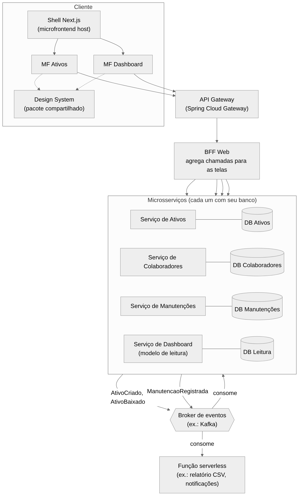

*Figura D.1 — Arquitetura-alvo **[Proposta de evolução]**. Nenhum dos elementos além de Gateway, backend e banco existe no código atual.*

**Caminho de migração sugerido:** (1) extrair o design system do frontend; (2) mover autenticação para o gateway; (3) extrair o módulo `manutencao` como primeiro serviço com banco próprio, aproveitando a porta `ManutencaoConsulta`; (4) publicar eventos e criar o modelo de leitura do dashboard.
